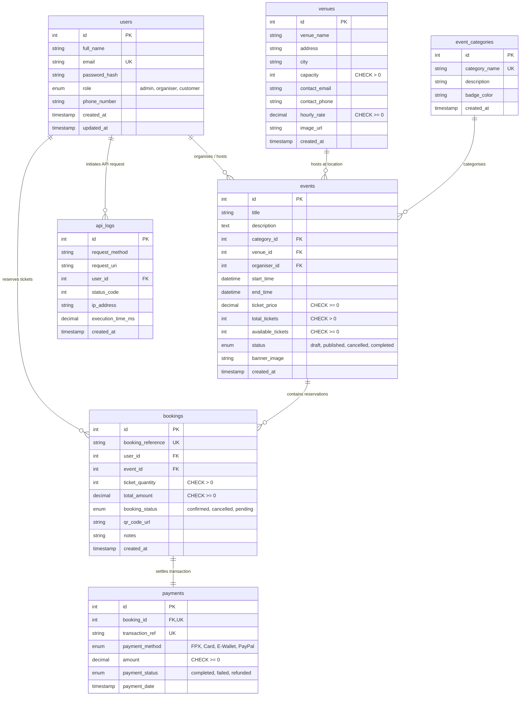

# Entity Relationship Diagram (ERD) & Database Specification

## Course Information
* **Course:** SWC3633/SWC4443 Web API Development
* **Project Title:** Development of a RESTful Web API for an Event Ticketing and Venue Booking System
* **Institution:** Universiti Poly-Tech Malaysia (UPTM)
* **Team:** Aidil Najmee Bin Che Jan (AM2412018166) & Project Group

---

## 1. Visual Entity Relationship Diagram (ERD)

The relational database model comprises **seven (7) normalized relational tables** enforcing relational integrity, foreign key cascading constraints, check constraints, and unique indices:

---

## 2. Data Dictionary & Table Specifications

### 2.1 Table: `users`
* **Purpose:** Stores user profiles, authentication credentials, and role privileges across the platform.
* **Primary Key:** `id` (INT, Auto Increment)

| Field Name | Data Type | Nullable | Constraints / Index | Description |
| :--- | :--- | :--- | :--- | :--- |
| `id` | INT | NO | PRIMARY KEY, AUTO_INCREMENT | Unique user identifier |
| `full_name` | VARCHAR(120) | NO | - | Legal user name |
| `email` | VARCHAR(150) | NO | UNIQUE, INDEX `idx_user_email` | Unique login email |
| `password_hash` | VARCHAR(255) | NO | - | BCRYPT hashed password string |
| `role` | ENUM | NO | DEFAULT 'customer', INDEX `idx_user_role` | `admin`, `organiser`, `customer` |
| `phone_number` | VARCHAR(30) | YES | - | Contact phone |
| `created_at` | TIMESTAMP | NO | DEFAULT CURRENT_TIMESTAMP | Account creation date |
| `updated_at` | TIMESTAMP | NO | DEFAULT CURRENT_TIMESTAMP ON UPDATE | Last modified timestamp |

### 2.2 Table: `venues`
* **Purpose:** Catalog of event facilities, auditoriums, and convention spaces.
* **Primary Key:** `id` (INT, Auto Increment)

| Field Name | Data Type | Nullable | Constraints / Index | Description |
| :--- | :--- | :--- | :--- | :--- |
| `id` | INT | NO | PRIMARY KEY, AUTO_INCREMENT | Venue identifier |
| `venue_name` | VARCHAR(150) | NO | - | Public venue name |
| `address` | VARCHAR(255) | NO | - | Street address |
| `city` | VARCHAR(100) | NO | INDEX `idx_venue_city` | Location city |
| `capacity` | INT | NO | CHECK (`capacity` > 0) | Maximum allowable attendees |
| `contact_email` | VARCHAR(150) | NO | - | Management contact email |
| `contact_phone` | VARCHAR(30) | NO | - | Management phone number |
| `hourly_rate` | DECIMAL(10,2) | NO | DEFAULT 0.00, CHECK (`hourly_rate` >= 0) | Facility rental cost per hour |
| `image_url` | VARCHAR(255) | YES | - | Architectural photo link |

### 2.3 Table: `event_categories`
* **Purpose:** Categorical classification for event discovery.
* **Primary Key:** `id` (INT, Auto Increment)

| Field Name | Data Type | Nullable | Constraints | Description |
| :--- | :--- | :--- | :--- | :--- |
| `id` | INT | NO | PRIMARY KEY, AUTO_INCREMENT | Category identifier |
| `category_name` | VARCHAR(80) | NO | UNIQUE | Category title |
| `description` | VARCHAR(255) | YES | - | Category overview |
| `badge_color` | VARCHAR(20) | YES | DEFAULT '#3b82f6' | Hex color for UI badge |

### 2.4 Table: `events`
* **Purpose:** Scheduled events hosted by organisers at contracted venues.
* **Primary Key:** `id` (INT, Auto Increment)

| Field Name | Data Type | Nullable | Constraints / Index | Description |
| :--- | :--- | :--- | :--- | :--- |
| `id` | INT | NO | PRIMARY KEY, AUTO_INCREMENT | Event identifier |
| `title` | VARCHAR(200) | NO | - | Event title |
| `description` | TEXT | NO | - | Comprehensive event details |
| `category_id` | INT | NO | FK -> `event_categories(id)` ON DELETE RESTRICT | Category classification |
| `venue_id` | INT | NO | FK -> `venues(id)` ON DELETE RESTRICT | Physical host venue |
| `organiser_id` | INT | NO | FK -> `users(id)` ON DELETE CASCADE | Event host account |
| `start_time` | DATETIME | NO | INDEX `idx_event_start` | Event start date & time |
| `end_time` | DATETIME | NO | - | Event end date & time |
| `ticket_price` | DECIMAL(10,2) | NO | CHECK (`ticket_price` >= 0), INDEX `idx_event_price` | Price per standard ticket |
| `total_tickets` | INT | NO | CHECK (`total_tickets` > 0) | Maximum tickets allocated |
| `available_tickets` | INT | NO | CHECK (`available_tickets` >= 0) | Remaining unbooked seats |
| `status` | ENUM | NO | DEFAULT 'published', INDEX `idx_event_status` | `draft`, `published`, `cancelled`, `completed` |
| `banner_image` | VARCHAR(255) | YES | - | Hero poster image link |

### 2.5 Table: `bookings`
* **Purpose:** Customer ticket reservations with genuine external QR code passes.
* **Primary Key:** `id` (INT, Auto Increment)

| Field Name | Data Type | Nullable | Constraints / Index | Description |
| :--- | :--- | :--- | :--- | :--- |
| `id` | INT | NO | PRIMARY KEY, AUTO_INCREMENT | Booking record ID |
| `booking_reference` | VARCHAR(50) | NO | UNIQUE, INDEX `idx_booking_ref` | Human-readable token (e.g. `BK-2026-001A`) |
| `user_id` | INT | NO | FK -> `users(id)` ON DELETE CASCADE | Purchasing customer |
| `event_id` | INT | NO | FK -> `events(id)` ON DELETE CASCADE | Reserved event |
| `ticket_quantity` | INT | NO | CHECK (`ticket_quantity` > 0) | Number of admissions |
| `total_amount` | DECIMAL(10,2) | NO | CHECK (`total_amount` >= 0) | Total charged cost |
| `booking_status` | ENUM | NO | DEFAULT 'confirmed', INDEX `idx_booking_status` | `confirmed`, `cancelled`, `pending` |
| `qr_code_url` | VARCHAR(500) | YES | - | URL from genuine external QR Code API |
| `notes` | VARCHAR(255) | YES | - | Customer seat notes |

### 2.6 Table: `payments`
* **Purpose:** Financial ledger of transaction settlements.
* **Primary Key:** `id` (INT, Auto Increment)

| Field Name | Data Type | Nullable | Constraints | Description |
| :--- | :--- | :--- | :--- | :--- |
| `id` | INT | NO | PRIMARY KEY, AUTO_INCREMENT | Payment transaction ID |
| `booking_id` | INT | NO | FK -> `bookings(id)` ON DELETE CASCADE, UNIQUE | Associated booking |
| `transaction_ref` | VARCHAR(100) | NO | UNIQUE | Payment gateway reference (`TXN-...`) |
| `payment_method` | ENUM | NO | - | `Online Banking (FPX)`, `Credit Card`, `E-Wallet`, `PayPal` |
| `amount` | DECIMAL(10,2) | NO | CHECK (`amount` >= 0) | Settled amount |
| `payment_status` | ENUM | NO | DEFAULT 'completed' | `completed`, `failed`, `refunded` |
| `payment_date` | TIMESTAMP | NO | DEFAULT CURRENT_TIMESTAMP | Payment settlement timestamp |

### 2.7 Table: `api_logs`
* **Purpose:** Telemetry audit trail for API management, rate limiting, and performance latency monitoring.
* **Primary Key:** `id` (INT, Auto Increment)

| Field Name | Data Type | Nullable | Constraints / Index | Description |
| :--- | :--- | :--- | :--- | :--- |
| `id` | INT | NO | PRIMARY KEY, AUTO_INCREMENT | Telemetry log ID |
| `request_method` | VARCHAR(10) | NO | - | HTTP verb (GET, POST, etc.) |
| `request_uri` | VARCHAR(255) | NO | - | Requested route endpoint |
| `user_id` | INT | YES | - | Requesting user ID or NULL |
| `status_code` | INT | NO | INDEX `idx_log_status` | HTTP response status code |
| `ip_address` | VARCHAR(45) | NO | - | Client IPv4/IPv6 address |
| `execution_time_ms` | DECIMAL(8,2) | NO | - | Request processing duration in milliseconds |
| `created_at` | TIMESTAMP | NO | DEFAULT CURRENT_TIMESTAMP, INDEX `idx_log_created` | Timestamp of request |

---

## 3. Relational Cardinalities and Business Integrity Rules

1. **User to Event (1:N):**
   * One user with role `organiser` can host zero or many events.
   * Each event is created by exactly one organizer (`organiser_id`).
2. **Venue to Event (1:N):**
   * One venue can host multiple events over time.
   * An event is assigned to exactly one venue.
   * `ON DELETE RESTRICT` ensures venues with existing event bookings cannot be deleted accidentally.
3. **Event to Booking (1:N):**
   * One published event can receive many customer bookings until `available_tickets = 0`.
   * When an event is deleted, cascaded bookings and payments are deleted (`ON DELETE CASCADE`).
4. **Booking to Payment (1:1):**
   * Each booking corresponds to exactly one payment transaction record.
5. **Business Rules Implemented in Code:**
   * An event's `total_tickets` cannot exceed its host venue's `capacity`.
   * An event's `end_time` must be strictly greater than its `start_time`.
   * Booking reservation decrements `available_tickets` inside an ACID transaction (`BEGIN TRANSACTION` ... `COMMIT`).
   * Booking cancellation immediately returns tickets back into `available_tickets` and updates payment status to `refunded`.

